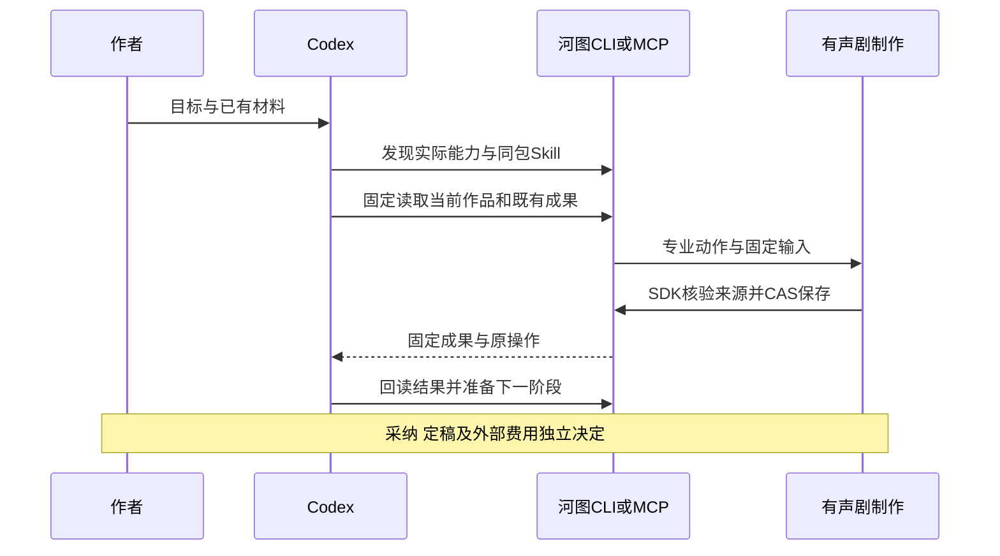

# Skill与机器协作

## 注册与发现

Skill随河图插件manifest声明，通过现有稳定CLI/MCP动态列出和按需读取；没有独立Codex插件、MCP服务或客户端工具名。安装/升级/启停后重新发现包和能力摘要。

## 方法要求

先读现有成果与来源，按实际覆盖组织本次目标；完成固定台本→角色与声音要求→外部录音或工具产出→核验真实PCM→选择片段→裁切增益声像淡入淡出→混音→听审返工→固定WAV及工程。动作参数以发现Schema为准，方法不赋予额外权限。跨作品Agent分别读取，专业插件不得合并management_ref。

首版执行PCM16 WAV混音，输入必须同采样率，支持单声道及双声道；不静默转码。输出立体声，片段有明确入出点、音量、声像和淡入淡出。峰值裁切、空白、未用录音和缺少台词覆盖如实报告。插件不内置TTS、克隆声音或模型调用；授权及费用由外部Agent与宿主固定计划处理。可解码、实际听取与作者认可分别登记。

包内SKILL保持简洁，operations导航实际动作，workflows承接专业正反例；测试需要当前Codex连接真的读取方法并完成至少一次专业动作。
